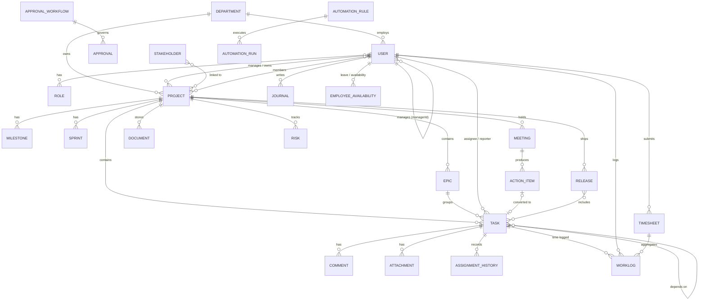

# Arihant Workspace - Database Design

> Source: architecture review approved on 2026-11-06. Update this document as the implementation evolves.

## 8. MongoDB collection design

All collections have `createdAt`/`updatedAt`. Collections marked * also get `deletedAt` soft delete and `createdBy`. References are ObjectIds.

| Collection                | Key fields                                                                                                                                                                                                                                                                                                                                                                                                                   | Key indexes                                                                                         |
| ------------------------- | ---------------------------------------------------------------------------------------------------------------------------------------------------------------------------------------------------------------------------------------------------------------------------------------------------------------------------------------------------------------------------------------------------------------------------- | --------------------------------------------------------------------------------------------------- |
| users*                    | employeeId, name, email, passwordHash, departmentId, designation, managerId, roleIds[], skills[{skillId, level 1–5}], weeklyCapacityHours (40), status (active/inactive/terminated), joinedAt, avatarKey, tokenVersion                                                                                                                                                                                                       | email u, employeeId u, departmentId, managerId                                                      |
| departments*              | name, code, headId, parentId                                                                                                                                                                                                                                                                                                                                                                                                 | code u                                                                                              |
| roles                     | name, key, isSystem, permissions[] (strings)                                                                                                                                                                                                                                                                                                                                                                                 | key u                                                                                               |
| permissions               | key `resource:action`, description, scopes allowed (seeded catalogue)                                                                                                                                                                                                                                                                                                                                                        | key u                                                                                               |
| skills                    | name, category                                                                                                                                                                                                                                                                                                                                                                                                               | name u                                                                                              |
| employeeAvailability      | userId, type (leave/holiday/partial), from, to, hoursPerDay, status (pending/approved/rejected), approvedBy                                                                                                                                                                                                                                                                                                                  | userId+from+to, status                                                                              |
| holidays                  | date, name, (org calendar)                                                                                                                                                                                                                                                                                                                                                                                                   | date u                                                                                              |
| projects*                 | key, name, description, category, departmentId, managerId, ownerId, members[{userId, projectRole}], priority, status, startDate, endDate, estimatedHours, budget{amount, currency INR}, objectives[], health{score, factors, computedAt}, progress, templateId, archivedAt, dependsOn[], settings{closureApproval, workflowId}, version                                                                                      | key u, status, departmentId, managerId, members.userId                                              |
| projectVersions           | projectId, version, snapshot, changedBy                                                                                                                                                                                                                                                                                                                                                                                      | projectId+version u                                                                                 |
| milestones                | projectId, name, dueDate, status, taskIds[]                                                                                                                                                                                                                                                                                                                                                                                  | projectId                                                                                           |
| sprints                   | projectId, name, start, end, goal, status                                                                                                                                                                                                                                                                                                                                                                                    | projectId                                                                                           |
| epics                     | projectId, key, name, status                                                                                                                                                                                                                                                                                                                                                                                                 | projectId                                                                                           |
| tasks*                    | key (`TRD-42`), projectId, epicId, parentId, title, description, assigneeId, reporterId, watchers[], priority (critical/high/medium/low), status, startDate, dueDate, estimatedHours, actualHours (denormalised), complexity (1–5), requiredSkills[], tags[], dependencies[{taskId, type FS}], checklist[], customFields{}, recurrence{rrule}, rank (lexorank for board order), assignmentVersion, blockedSince, completedAt | key u, projectId+status+rank, assigneeId+status, dueDate+status, parentId, text(title, description) |
| comments                  | entityType, entityId, parentId (threads), authorId, body, mentions[]                                                                                                                                                                                                                                                                                                                                                         | entityType+entityId+createdAt                                                                       |
| attachments               | entityType, entityId, storageKey, fileName, mime, size, uploadedBy                                                                                                                                                                                                                                                                                                                                                           | entityType+entityId                                                                                 |
| worklogs                  | userId, projectId, taskId, date (org-TZ day), start, end, minutes, description, category, status, source (timer/manual), timesheetId, locked                                                                                                                                                                                                                                                                                 | userId+date, taskId, projectId+date; **partial unique {userId} where end=null** (one running timer) |
| timesheets                | userId, period{type, start, end}, totalMinutes, status (draft/submitted/approved/rejected), approverId, history[]                                                                                                                                                                                                                                                                                                            | userId+period.start u                                                                               |
| journals                  | userId, date, completed, inProgress, blockers, tomorrow                                                                                                                                                                                                                                                                                                                                                                      | userId+date u                                                                                       |
| meetings                  | projectId, title, start, end, participants[], agenda[], minutes, decisions[], actionItems[{text, assigneeId, dueDate, priority, taskId}], followUpOf                                                                                                                                                                                                                                                                         | projectId+start, participants                                                                       |
| documents*                | title, category (BRD/FRD/SRS/…), projectId, currentVersion, versions[{v, storageKey, size, uploadedBy, at}], acl{roles[], userIds[]}, status (draft/pending/published)                                                                                                                                                                                                                                                       | projectId, category, text(title)                                                                    |
| risks*                    | projectId, type (risk/issue/blocker), title, severity, probability 1–5, impact 1–5, score, ownerId, mitigation, status, escalationLevel, history[]                                                                                                                                                                                                                                                                           | projectId+status, type                                                                              |
| approvalWorkflows         | key, entityType, stages[{name, approverRule (role/user/manager/deptHead), slaHours}]                                                                                                                                                                                                                                                                                                                                         | key u                                                                                               |
| approvals                 | workflowId, entityType, entityId, currentStage, status, steps[{stage, approverId, delegateId, decision, reason, at}], requestedBy                                                                                                                                                                                                                                                                                            | entityType+entityId, steps.approverId+status                                                        |
| releases                  | projectId, version, notes, environments[{env, status, deployedAt, build, by}], taskIds[], status, approvalId, rollbacks[]                                                                                                                                                                                                                                                                                                    | projectId+version u                                                                                 |
| stakeholders*             | name, org, email, type (client/internal), projectIds[], portalUserId                                                                                                                                                                                                                                                                                                                                                         | email                                                                                               |
| changeRequests / feedback | projectId, stakeholderId, …                                                                                                                                                                                                                                                                                                                                                                                                  | projectId                                                                                           |
| notifications             | userId, type, title, body, link, readAt, channel                                                                                                                                                                                                                                                                                                                                                                             | userId+readAt+createdAt, TTL 180 d                                                                  |
| notificationPrefs         | userId, perType{inApp, email}                                                                                                                                                                                                                                                                                                                                                                                                | userId u                                                                                            |
| activities                | actorId, entityType, entityId, projectId, verb, diff                                                                                                                                                                                                                                                                                                                                                                         | projectId+createdAt, entityType+entityId                                                            |
| auditLogs                 | actorId, action, entityType, entityId, before, after, ip, ua, requestId                                                                                                                                                                                                                                                                                                                                                      | createdAt, actorId, entityType+entityId (append-only)                                               |
| loginHistory              | userId, ip, ua, success, at                                                                                                                                                                                                                                                                                                                                                                                                  | userId+at, TTL 1 y                                                                                  |
| refreshTokens             | userId, familyId, tokenHash, expiresAt, revokedAt, replacedBy                                                                                                                                                                                                                                                                                                                                                                | tokenHash u, familyId, TTL expiresAt                                                                |
| assignmentHistories       | taskId, fromUserId, toUserId, method (auto/manual/suggested/batch/reassign/rebalance), score, breakdown, reason, triggeredBy (user/automation), batchId                                                                                                                                                                                                                                                                      | taskId+createdAt, toUserId                                                                          |
| assignmentPlans           | batchId, scope, proposals[], skipped[{taskId, reason}], status (draft/approved/rejected/executed/expired), idempotencyKey                                                                                                                                                                                                                                                                                                    | idempotencyKey u, TTL on drafts 24 h                                                                |
| automationRules           | name, enabled, trigger{type: event/schedule, event?, cron?}, conditions (JSON logic tree), actions[], scope, runCount, lastRunAt                                                                                                                                                                                                                                                                                             | trigger.event+enabled                                                                               |
| automationRuns            | ruleId, triggerRef, status, attempts, error, durationMs                                                                                                                                                                                                                                                                                                                                                                      | ruleId+createdAt, TTL 90 d                                                                          |
| savedViews                | userId, module, name, filters, columns, shared                                                                                                                                                                                                                                                                                                                                                                               | userId+module                                                                                       |
| counters                  | _id (e.g. `task:TRD`), seq                                                                                                                                                                                                                                                                                                                                                                                                   | —                                                                                                   |
| settings                  | key, value (org TZ, work week, capacity default, weights, …)                                                                                                                                                                                                                                                                                                                                                                 | key u                                                                                               |

**Transactions** (they need a replica set; Docker runs a single-node RS in development and 3 nodes in production) cover: task assignment plus history, timesheet submit plus log lock, approval step plus entity status, project duplication, and plan execution.
**Pagination:** offset for admin tables, cursor (`_id`/`createdAt`) for feeds and logs.
**Reporting:** aggregation pipelines over indexed fields. A nightly `dailySnapshots` collection (project/department/user metrics per day) provides historical trends, burndown and cumulative-flow data without replaying history.

## 9. Entity relationships

```
Department 1─* User (*─1 manager User)      User *─* Role ─* Permission
Department 1─* Project ─1 manager/owner User; Project *─* User (members)
Project 1─* Epic 1─* Task 1─* Subtask(Task.parentId); Task *─* Task (dependencies)
Project 1─* Milestone *─* Task; Project 1─* Sprint 1─* Task
Task 1─* Comment/Attachment/Activity/AssignmentHistory/WorkLog
User 1─* WorkLog *─1 Timesheet; User 1─* Journal; User 1─* EmployeeAvailability
Project 1─* Meeting 1─* ActionItem ─0..1 Task
Project 1─* Document(versions); Project 1─* Risk; Project 1─* Release *─* Task
Approval *─1 ApprovalWorkflow; Approval ─1 (any entity, polymorphic)
Stakeholder *─* Project; AutomationRule 1─* AutomationRun
```

A full Mermaid ER diagram goes into `docs/database-design.md`.

## ER diagram (core entities)



## Implemented so far

| Collection            | Status                | Notes                                                                                                                                                                                                                         |
| --------------------- | --------------------- | ----------------------------------------------------------------------------------------------------------------------------------------------------------------------------------------------------------------------------- |
| `counters`            | Implemented (Phase 1) | `server/src/core/idgen.ts`: atomic `$inc` sequences; `nextKey('TRD')` gives `TRD-1`, `TRD-2`, and so on. Concurrency-tested with 50 parallel requests.                                                                        |
| `users`               | Implemented (Phase 2) | Unique `email`, `employeeId`; `passwordHash` never selected by default; `tokenVersion`, lockout fields; skills embedded as `{name, level}`.                                                                                   |
| `roles`               | Implemented (Phase 2) | 9 system roles seeded idempotently at API start; grants `[{permission, scope}]`; custom roles keyed `custom_<slug>`.                                                                                                          |
| `departments`         | Implemented (Phase 2) | Soft delete via `archived`; partial unique index on `code` among active departments.                                                                                                                                          |
| `skills`              | Implemented (Phase 2) | Catalogue for autocomplete; unique lower-cased `normalized`.                                                                                                                                                                  |
| `refreshTokens`       | Implemented (Phase 2) | Hash only; `familyId` for reuse detection; TTL index on `expiresAt`.                                                                                                                                                          |
| `passwordResets`      | Implemented (Phase 2) | Invite/reset links, hash only, single use; purged 7 days after expiry.                                                                                                                                                        |
| `loginHistory`        | Implemented (Phase 2) | Every attempt with reason; TTL 1 year.                                                                                                                                                                                        |
| `auditLogs`           | Implemented (Phase 2) | Append-only (update/delete hooks throw); secrets redacted from snapshots.                                                                                                                                                     |
| `settings`            | Implemented (Phase 2) | Key `org`: name, timezone, working days, hours, default capacity, fiscal year start.                                                                                                                                          |
| `projects`            | Implemented (Phase 3) | Unique `key`; members `[{userId, role}]`; date-only fields stored as `YYYY-MM-DD` strings; `version` for optimistic concurrency; `archived` flag.                                                                             |
| `projectVersions`     | Implemented (Phase 3) | One document per edit with field-level before/after changes.                                                                                                                                                                  |
| `tasks`               | Implemented (Phase 3) | Unique `key` (`TRD-42`); `rank` (fractional index) per status column; `priorityOrder` for sorting; `dependencyIds`; embedded checklist; `assignmentVersion`; soft delete. Index `{projectId, status, rank}` serves the board. |
| `comments`            | Implemented (Phase 3) | Threaded (`parentId`), `mentions`, soft delete.                                                                                                                                                                               |
| `attachments`         | Implemented (Phase 3) | Metadata only; bytes in object storage under random keys.                                                                                                                                                                     |
| `activities`          | Implemented (Phase 3) | User-facing feed per project/task with field changes (separate from the immutable audit log).                                                                                                                                 |
| `assignmentHistories` | Implemented (Phase 3) | Manual assignments now; smart assignment (Phase 4) adds score and reason.                                                                                                                                                     |
| `savedViews`          | Implemented (Phase 3) | Per-user task views; unique per user and name.                                                                                                                                                                                |
| `worklogs`            | Implemented (Phase 4) | `date` (org day), optional `startedAt`/`endedAt` for overlap checks, `source` timer/manual. Indexes `{userId, date}`, `{taskId}`, `{userId, startedAt, endedAt}`.                                                             |
| `timers`              | Implemented (Phase 4) | Unique `userId` (one timer per person); `runningSince` + `accumulatedMs` support pause/resume.                                                                                                                                |
| `timesheets`          | Implemented (Phase 4) | Unique `{userId, weekStart}`; status history.                                                                                                                                                                                 |
| `journals`            | Implemented (Phase 4) | Unique `{userId, date}`.                                                                                                                                                                                                      |
| `availability`        | Implemented (Phase 4) | Leave / partial availability with approval.                                                                                                                                                                                   |
| `assignmentPlans`     | Implemented (Phase 4) | Proposals with expected `assignmentVersion`, skipped and manual-review lists, unique `idempotencyKey`, 24 h preview expiry.                                                                                                   |
| `locks`               | Implemented (Phase 4) | Distributed locks with TTL expiry.                                                                                                                                                                                            |

| `risks` | Implemented (Phase 5A) | Unique `key` (`TRD-R1`); probability, impact, score, severity; status history; escalation level; soft delete. Indexes `{projectId, status, score}`, `{ownerId, status}`, `{status, severity}`. |
| `dailySnapshots` | Implemented (Phase 5A) | One per project per day (unique `{projectId, date}`): tasks by status, effort, overdue, open risks, health score. Written nightly at 23:30 org time. |

| `milestones` | Implemented (Phase 5B) | `projectId`, `name`, `dueDate` (YYYY-MM-DD), `status` open/completed, `completedAt`. Indexes `{projectId, dueDate}`, `{status, dueDate}`. |
| `projectTemplates` | Implemented (Phase 5B) | Name, defaults, custom field definitions, milestones and tasks with day offsets and internal refs (validated by the shared schema), `usageCount`, `createdBy`, `archived`. |
| `projects` (5B fields) | Implemented (Phase 5B) | `customFields` definitions, `dependsOn [{projectId, note}]` (index `dependsOn.projectId`), `templateId`. |
| `tasks` (5B fields) | Implemented (Phase 5B) | `milestoneId`, `recurrence`, `recurrenceSeriesId`, `recurrenceIndex`, `nextOccurrenceId` (claimed atomically so a series continues once), `customFields`. Indexes `{milestoneId, status}`, `{recurrenceSeriesId}`. |

| `notifications` | Implemented (Phase 6A) | `userId`, `type`, `title`, `body`, `link`, `actorId`, `readAt`. Index `{userId, readAt, createdAt}`; TTL 180 days. |
| `notificationPrefs` | Implemented (Phase 6A) | Unique `userId`; `emailEnabled`, per-type `email` switches. |
| `approvalWorkflows` | Implemented (Phase 6A) | One per entity type (unique); stage definitions. Created with defaults on first use. |
| `approvals` | Implemented (Phase 6A) | Key `APR-n`; stage snapshot with resolved approvers, decisions, deadlines and reminder flags; `pendingApproverIds` for the inbox; history; `version` for optimistic concurrency. |
| `meetings` | Implemented (Phase 6A) | Project, times, organiser, participants, agenda, minutes, decisions, action items (`taskId` once converted), soft delete. Indexes `{projectId, startAt}`, `{participantIds, startAt}`. |

| `automationRules` | Implemented (Phase 7A) | Trigger, conditions, actions, project or organisation scope, owner (actions run with the owner's permissions), run counters, soft delete. |
| `automationRuns` | Implemented (Phase 7A) | Unique `{ruleId, eventId}` (each event once), status, per-action results, error, duration; TTL 90 days. |
| `automationRules` (7B fields) | Implemented (Phase 7B) | `schedule` and `lastScheduledSlot` (claimed atomically so each hourly slot runs once). |
| `aiUsage` | Implemented (Phase 7A) | Person, feature, model, token counts and status only (no prompt or response content); TTL 1 year. AI settings live in `settings` (key `ai`). |

| `documents` | Implemented (Phase 6B) | Project, title, category, tags, status (draft / pending_approval / published / archived), `sharedWithStakeholders`, embedded versions `[{version, storageKey, fileName, mime, size, note, uploadedBy, uploadedAt}]`, `currentVersion`, `publishedVersion`; soft delete. Bytes in object storage under `documents/<projectId>/<uuid>`. |
| `releases` | Implemented (Phase 6B) | Unique `{projectId, version}`; status; `taskIds`; environments dev / qa / uat / prod with status, build, time and person; history of deployments, rollbacks and approvals. |
| `stakeholders` | Implemented (Phase 6B) | Name, organisation, role, type, contact details (e-mail lower-cased), influence, interest, `projectIds`, notes; soft delete. |
| `changeRequests` | Implemented (Phase 6B) | Unique key `CR-n`; project, stakeholder, requester, impacts, priority, effort, cost and schedule impact, status, `implementationTaskId`. |
| `feedback` | Implemented (Phase 6B) | Project, stakeholder, rating 1-5, category, comment, `receivedOn`, recorded by. |
| `approvals` (6B fields) | Implemented (Phase 6B) | `entityId` links a request to its record (index `{entityType, entityId, status}`); stage `fallbackOnly`. |

| `sprints` | Implemented (Phase 9A) | Project, number (unique per project), name, goal, status, dates, commitment and completion snapshots (task ids and points), carried-over task ids. Partial unique index: one active sprint per project. |
| `tasks` (9A fields) | Implemented (Phase 9A) | `type`, `storyPoints`, `epicId`, `sprintId`, `backlogRank`, `components`, `fixReleaseId`, `acceptanceCriteria`, `remainingHours`, `bug` (embedded), `links [{type, taskId}]`, `startedAt`, `previousKeys`. Indexes `{sprintId, status}`, `{epicId}`, `{projectId, type, status}`, `{links.taskId}`, `{fixReleaseId}`, `{previousKeys}`. |
| `projects` (9A fields) | Implemented (Phase 9A) | `components [{name, description, leadId}]`, `wipLimits`. |

| `gitLinks` | Implemented (git integration) | Provider, kind (commit / pull_request), repository, ref (SHA or #number), task, project, title, URL, author, branch, PR state, whether it moved the task, time. Unique `{provider, kind, repo, ref, taskId}`; index `{taskId, occurredAt}`. |
| `requestTypes` | Implemented (9G) | Project, name (unique per project), kind, form fields, default priority, requester-chosen urgency, SLA hours, approval, help links, active. Tasks gain `serviceRequest` (type, kind, requester, answers, response / resolution due, first response, awaiting approval, alerts sent, rating); projects gain `serviceDesk` (enabled, agents, auto-assign, next agent); comments gain `visibleToRequester`. |
| `reportSubscriptions` | Implemented (9H) | Owner, name, report (filter / snapshot), filter, format, frequency, day of week / month, hour, recipients, active, next run (claimed before sending), last run and result. |
| `outboundHooks` | Implemented (9F) | Name, kind (webhook / slack / teams), encrypted URL and preview, encrypted signing secret, events, project filter, active, consecutive failures, switch-off reason. |
| `hookDeliveries` | Implemented (9F) | Destination, event, payload, status (pending / delivered / failed), attempts, HTTP status, error, duration, next attempt; TTL 30 days. |
| `webLinks` | Implemented (9F) | Task, project, https URL, title, detected tool, added by. Git links now record the provider (github / gitlab / bitbucket). |
| `apiTokens` | Implemented (9E) | Owner, name, prefix (for recognition), SHA-256 hash (unique), scope, expiry, last use (time, IP), revoked at. |
| `ssoStates` | Implemented (9E) | Pending single sign-on: state (unique), nonce, PKCE verifier; TTL 10 minutes, deleted on use. |
| `users` (9E fields) | Implemented (9E) | `mfa` (enabled, encrypted secret, pending secret, enabled at, last used step, hashed recovery codes; never selected by default), `ssoSubject`. Tasks gain `restricted` and `allowedUserIds`; projects gain `confidential`. Security settings live in `settings` (key `security`). |
| `taskWorkflows` | Implemented (9C) | Name (unique), description, definition (statuses, labels, required fields, transitions), version (optimistic), creator. Projects reference one through `workflowId` (null = standard). |
| `taskTransitions` | Implemented (9C) | Task, project, from, to, transition name, channel (user / board / bulk / git / approval / automation / workflow_change / create), actor, comment, time in previous status, time. Index `{taskId, at}`. Tasks also carry `pendingTransition` while a move waits for approval. |
| `savedFilters` | Implemented (9D) | Owner, name (unique per owner), description, query text, sharing (private / project / org), project, people who starred it. |
| `searchHistory` | Implemented (9D) | Person, query, result count, time. Unique `{userId, aql}`; last 30 kept; TTL 90 days. |
| `filterGadgets` | Implemented (9D) | Person, saved filter, chart (count / bar / list), grouping, position. |
| `gitDeliveries` | Implemented (git integration) | Webhook delivery id (unique, for deduplication), event, repository, outcome; TTL 30 days. Settings live in `settings` (key `git`). |

Every other collection is created in its module's phase.
